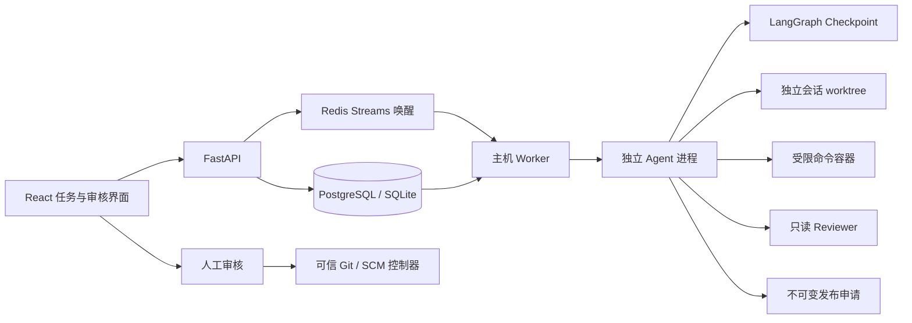

# CodePilot 架构与工程取舍

## 核心链路

## 为什么不是单纯加一个消息队列

HTTP 原先等待 Agent 完成，且执行状态受 Web 进程生命周期影响。现在提交事务同时写入任务与首个事件，再发送 Redis 通知。通知失败仍可通过数据库轮询领取，避免数据库/Redis 双写之间丢任务。

PostgreSQL 使用 `FOR UPDATE SKIP LOCKED` 领取，SQLite 使用 `BEGIN IMMEDIATE`。部分唯一索引限制同一 thread 只有一个活动 run。`Idempotency-Key` 与请求内容摘要绑定，同 key 不同内容返回 409。

## 租约与恢复语义

状态包括 queued、running、cancelling、completed、failed、cancelled、interrupted。每次领取产生新的 lease token，心跳、终态、事件写入均校验 token。过期任务转 interrupted，不自动从头重跑具有外部副作用的操作。

恢复需要保存的执行上下文和真实 Checkpoint，并要求操作者核对外部效果。未完成图继续 `input=None`；图已完成则从快照补写可展示结果。数据库状态与模型输出不是同一个事务，无法声称端到端 exactly-once。未知发布结果保留 uncertain/executing，需要人工核对，不会自动重发。

Windows 使用启动时挂起进程、分配 kill-on-close Job Object 后再恢复执行；取消、超时、监督进程退出会终止所拥有的进程树。Linux 使用独立进程组和看门狗。容器带 run 标签，正常取消时由监督进程清理；即使控制器崩溃，命令仍有容器内最长 300 秒的硬超时。跨进程崩溃恢复前应核对残留容器和外部操作，租约不是内核级沙箱。

## 执行与审查边界

同一会话保持一个 worktree，不同会话的文件目录隔离；共享 bare mirror 复用 Git 对象。Docker 命令只挂载本会话 projects，不挂载 mirror、其他会话或密钥。Git 提交和发布通过结构化控制器完成，容器不需要读取 worktree 的宿主机 Git 元数据。

DeepAgents 0.6.11 的普通子 Agent spec 继承父 backend；随意加 `backend` 字段不会形成隔离。这里使用单独编译的只读图作为 Reviewer runnable，测试中让模拟模型主动请求写文件，验证写入确实被拒绝。

Finding 校验相对路径、文件存在性、严重度及基准 diff 的新增/修改行，并按 run、diff 摘要、位置和规范化标题去重。diff 包含未跟踪新增文件，并遵守敏感路径排除策略。纯删除问题仍需输出整体说明，复杂重命名定位尚未专门覆盖。

`POST /api/reviews` 通过 GitHub API 固定 PR base/head SHA；Worker 从已验证仓库拉取 `refs/pull/N/head`，再次比对 head，使用 merge-base 生成三点比较语义的 diff。仓库在排队期间更新会导致旧请求失败，避免悄悄审查另一版本。GitHub 接口依据 [官方 PR 文档](https://docs.github.com/en/rest/pulls/pulls)。

`POST /api/runs/{id}/repairs` 接收用户选定的 finding IDs、diff 摘要和容器验收命令，在同一事务中记录确认与创建修复任务。重复确认返回相同任务；已处理 finding 不接受另一条修复指令。Worker 修改文件前检查当前 head/diff 与批准快照一致，完成编码后执行验收命令，再调用独立只读 Reviewer 复审。验收失败则任务失败，保留文件和证据；复审剩余发现可进入下一轮确认。通过测试不等价于 Reviewer 证明程序完全正确。

## 发布审批

Agent 只能提交参数不可变的申请。操作指纹绑定 run、类型和完整参数；API 只允许在任务完成后执行。推送绑定具体 commit，而不是执行时读取可变 HEAD。GitHub PR 以 draft 发布；请求前查询同 head/base 的已有 PR。

审批执行前先将记录改为 executing，网络返回后保存结果。超时或进程退出不能证明远端失败，故禁止重复自动发布。现在没有“强制重试 uncertain”的按钮，需人工核对并通过新的明确任务处理。

## 上下文与观测

缓存 key 由缓存格式版本、仓库 origin 和提交 SHA 生成，记录结构、测试路径、有限的配置/README 片段及 Git blob SHA。文件片段再按 blob SHA 缓存：仅代码提交而 README/技术约定未变时复用片段，原子替换缓存文件防止并发读到半份 JSON；工作区有未提交变化就跳过版本缓存。

任务完成前写入按仓库、提交组织的历史摘要；检索只包含执行状态 completed 的任务，保留 run_id、message_id 和事件查询路径，标注是否同一提交。摘要最多 5 条，每条限制长度，并明确作为历史证据而非执行指令。它是确定性证据缓存，不是向量检索系统。

执行事件只追加，以序号回放；同一 run 的状态和对应事件在事务内提交。页面通过 SSE 触发快照更新，重放不会把相同 token 再追加一次。历史课程事件表保留用于兼容展示，可靠状态以 execution_runs 为准。

API 使用 OpenTelemetry span，将 W3C traceparent 随任务规格持久化；独立执行进程提取该上下文，创建 workspace、context、implement、verify、re_review 阶段 span。进程专属 JSONL 导出文件保存 trace/span/parent ID，不导出提示词或凭据。阶段事件、失败类型和 Token 回调进入持久化事件表，`/metrics` 按 call_id 聚合用量，页面展示运行证据。尚未部署 OTLP Collector，事件归档与成本预算仍是生产化扩展项。

硬超时已有执行上下文时进入 interrupted，核对后可以显式恢复；恢复次数默认最多 3 次（`CODEPILOT_MAX_ATTEMPTS`），不盲目重放外部发布。模型输出非法工具 JSON 时，中间件先为该 tool_call_id 补错误回执，再在模型调用预算内重试；不执行非法参数，也不通过丢弃消息来掩盖协议错误。

## 可据实使用的项目表述

**CodePilot：可恢复 AI Coding Agent 协作平台**

- 拆分 FastAPI 与独立 Worker，以数据库任务队列、Redis Streams 唤醒、租约令牌和 LangGraph Checkpoint 管理长任务，支持取消、超时、幂等提交、显式恢复与 SSE 事件回放。
- 基于会话级 Git worktree 隔离代码目录，使用禁网、非 root、资源受限容器执行生成代码；将凭据保留在可信控制器，推送和 PR 发布通过不可变参数审批及不确定结果阻断控制重复副作用。
- 基于 PR base/head 提交构建审查快照，结合独立只读 Reviewer、diff 行号校验与去重，将人工确认、快照校验、代码修复、容器验收与复审串成可追踪流程。
- 按仓库与提交缓存结构、测试入口及技术约定，复用未变更文件的 blob 摘要；维护带任务与消息来源的历史摘要，对脏工作区失效并按需检索文件。
- 建立覆盖缺陷修复、功能实现和审查的固定评测集，统计任务成功率、审查定位精确率/召回率、经复现裁定的有效缺陷率、耗时及 Token；通过跨进程 Trace 与事件回放定位失败阶段。

不要添加未经测量的生产规模、客户数量或通用成功率。8 个合成样例上的对照记录见 [目标对标与验收](TARGET_ALIGNMENT.md)，不能当作大规模真实 Issue benchmark。
