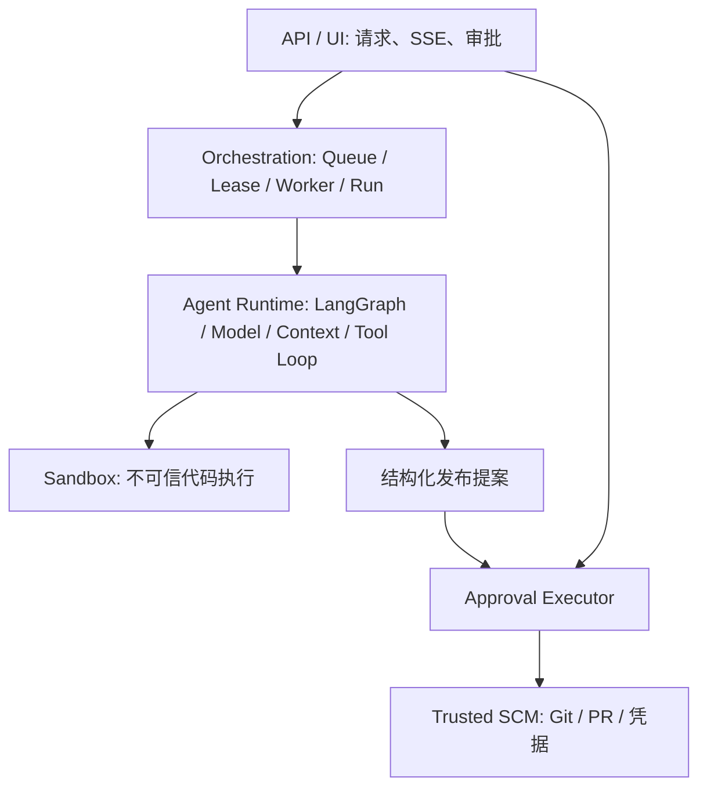

# 失败语义与恢复

## Run 状态

| 状态 | 含义 | 后续行为 |
| --- | --- | --- |
| queued | 数据库已持久化，尚未领取 | Worker DB polling 可领取，Redis 丢失不影响事实源 |
| running | Worker 持有效 lease_token 执行 | Heartbeat 续租，写状态/事件需 fencing 校验 |
| cancelling | 请求停止正在运行的任务 | Supervisor 回收进程树及任务容器后结束 |
| completed | 执行进程成功退出 | 不代表生成代码一定正确；审查/验收证据另行判断 |
| failed | 已知执行失败 | 排查原因后新建任务；不盲目恢复 |
| cancelled | 已停止或在排队阶段取消 | 不重新领取 |
| interrupted | 执行被中断或租约过期 | 满足前置条件后显式恢复 |

Worker 被强制终止后无法再续租。其他 Worker 调用 recover_expired 将运行置为 interrupted；不会立刻重放模型或副作用。旧 Worker 的 token、过期时间、运行状态任一不匹配都会拒绝 finish、事件追加和其他受保护写入；新一次 claim 生成不同 token。

恢复要求：interrupted、有持久化执行上下文、无同会话活动任务、未超过默认三次尝试，以及旧租约后五秒的回收宽限期。API 必须明确收到 `external_effects_checked=true`。该确认表示操作者已核对 Git/PR 等远端结果；不是平台能证明远端副作用回滚的标志。

LangGraph 从保存的 checkpoint 继续，已提交的节点结果可复用。节点执行与外部系统请求不是一个分布式事务：远端已接受、本地尚未记账时崩溃，节点可能面临不确定结果。因此 Checkpoint 不等于 Exactly Once，幂等操作记录也不能凭空消除网络的不确定性。

## Operation 状态

`proposed → approved → executing → completed / uncertain`

approved 与 executing 分别落库并追加事件。若在 approved 后崩溃，尚未有执行者领取，操作者可再次明确调用批准接口；后台不会自动发送。executing 先于网络调用提交，因此另一请求不能重复发送。completed 返回此前结果。uncertain 或崩溃残留 executing 均拒绝再次执行，必须人工核对远端。

旧版 pending 映射为 proposed；旧 post_comment 映射为 comment_pr，但旧记录的指纹仍按原始 kind 计算，不改写操作 ID。当前不提供自动解除 uncertain 的 API，避免误判后重复发布。

## 逻辑分层

保留现有物理模块，避免为分层搬动稳定实现。Redis 是通知优化，数据库是任务与事件事实源；SSE 游标来自持久化事件序号，断线从游标之后读取。运行状态变更与相应事件写入同一数据库事务。
