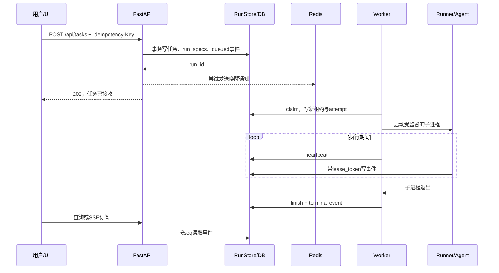
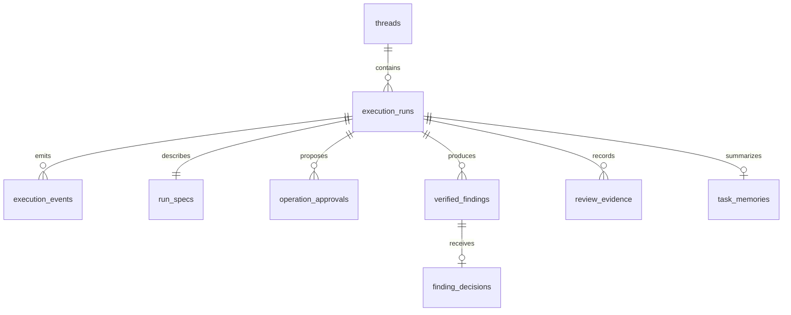
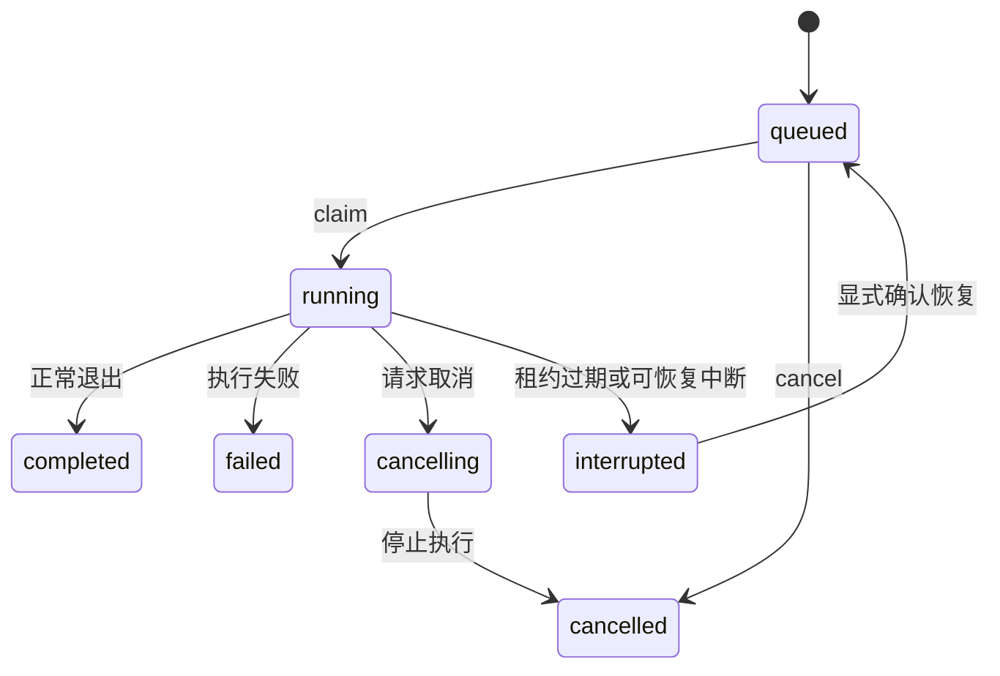

# CodePilot 学习与面试教程

> 面向：具备 Python 基础，希望应聘 AI Agent / LLM Application / Agent Infra 实习岗位的开发者。  
> 目标：能画架构、跟踪请求、解释失败、运行实验，并用真实证据回答追问。  
> 核对日期：2026-10-12。依据当前源码、P0–P3 验收记录编写；P4 故障实验已有未验收代码，P5 对照实验尚未完成。

## 阅读导航

1. [先建立项目认知](#1-先建立项目认知)
2. [学习路线与掌握标准](#2-学习路线与掌握标准)
3. [运行环境与第一次启动](#3-运行环境与第一次启动)
4. [跟踪一条完整任务](#4-跟踪一条完整任务)
5. [数据库设计：面试重点](#5-数据库设计面试重点)
6. [可靠执行：队列、租约、恢复](#6-可靠执行队列租约恢复)
7. [安全执行：worktree、容器、审批](#7-安全执行worktree容器审批)
8. [审查闭环：证据与人工确认](#8-审查闭环证据与人工确认)
9. [上下文管理与框架边界](#9-上下文管理与框架边界)
10. [SSE、Trace 与故障定位](#10-ssetrace-与故障定位)
11. [评测：怎样证明项目有效](#11-评测怎样证明项目有效)
12. [动手实验](#12-动手实验)
13. [面试表达与追问](#13-面试表达与追问)
14. [练习任务与最终自测](#14-练习任务与最终自测)

建议边读边打开源码。文中“简化代码”用于讲解，不替代真实事务、异常处理和权限检查。

## 1. 先建立项目认知

### 1.1 一句话介绍

CodePilot 是一个面向研发任务的可恢复 AI Coding Agent 平台，围绕长任务调度、受限代码执行、人工发布审批和审查证据，管理模型完成研发任务时的工程风险。

这个定位的重点是 **Agent Harness / Runtime Engineering**：为模型提供受约束的运行环境，并规定任务什么时候开始、谁拥有执行权、失败后如何处理、什么证据支持结果。

这里有三个层次：

| 层次 | 负责什么 | 本项目对应实现 |
| --- | --- | --- |
| 模型 | 理解需求，生成下一步文本或工具参数 | DeepSeek，经 ChatOpenAI 兼容接口调用 |
| Agent 图 | 组织模型、工具、状态和多轮调用 | DeepAgents、LangGraph、middleware |
| Harness | 管理执行生命周期、权限、持久化、恢复、验收 | RunStore、Worker、DockerBackend、Approval、Review Evidence |

不要把模型、Agent 和 Harness 当作同一个概念。模型能够生成一段修复代码，不表示平台能够安全执行、验证并发布它。

### 1.2 用一个实际需求理解项目

用户提交：“修复某仓库参数解析的边界问题，增加测试。”

平台需要处理的不只有代码生成：

1. 请求已经入库，但 HTTP 响应丢失，用户再次点击提交怎么办？
2. 两个 Worker 同时发现任务，怎样避免都执行？
3. Worker 执行到一半崩溃，如何保留工作区和图状态？
4. 仓库中的代码要求读取宿主机密钥，系统能否拒绝？
5. 模型说“测试通过”，是否真的存在测试执行证据？
6. PR 已在远端创建，但本地超时，是否可以再创建一次？

你能回答这些问题，才算理解本项目的工程价值。

### 1.3 当前实现与证据边界

| 内容 | 当前状态 | 面试表述 |
| --- | --- | --- |
| 持久化队列、租约、取消、事件回放 | 已有实现与回归测试 | 可以结合源码和测试解释 |
| PostgreSQL、Redis、Docker 集成 | P3 基线集成回归已通过 | 可以说本地集成验证通过 |
| 固定仓库评测 | 20 例完成真实模型运行 | 必须带任务范围与失败结果 |
| 实际 kill Worker 的 P4 专项实验 | 已编写，尚未验收 | 不报恢复率，不说实验已通过 |
| 四种 ContextStrategy 对照 | 尚未完成 | 作为后续改进方案 |
| 远端 GitHub Actions | 尚未确认本轮远端运行 | 不把本地通过说成 CI Green |
| 多租户、生产 SLO、真实企业规模 | 当前没有相应证据 | 不作相关声明 |

P3 最近已验收基线：62 项后端测试通过，包含 PostgreSQL、Redis、Docker。当前目录另有待验收的 P4 测试，不能把“62 项基线通过”解释为新加入的全部测试也已通过。

出处：[升级记录](UPGRADE_EXECUTION.md)、[评测结果](benchmark/latest-summary.md)、[能力来源](OWNERSHIP.md)。

## 2. 学习路线与掌握标准

### 2.1 先补这些基础

| 基础 | 需要达到的程度 |
| --- | --- |
| Python | 能读异常处理、上下文管理器、线程、subprocess、环境变量 |
| HTTP / FastAPI | 理解请求校验、202、409、SSE，以及同步数据库操作为何放入线程 |
| SQL | 理解事务、唯一索引、行锁、条件更新，能写 SELECT 排查任务 |
| Git | 区分工作区、暂存区、commit、branch、worktree |
| Docker | 理解镜像、容器、挂载、用户、网络和资源限制 |
| LLM Agent | 理解消息、tool call、工具结果、循环、上下文长度与 Token |

不必先学完整分布式系统课程。每遇到一个概念，用本项目的失败场景理解它。

### 2.2 推荐 14 天学习安排

每天约 1.5–2 小时：读代码 40 分钟、实验 40 分钟、脱稿复述 20 分钟。

| 天数 | 内容 | 当天交付物 |
| --- | --- | --- |
| 1 | 项目定位、技术栈、运行方式 | 画一张架构图，讲清三个层次 |
| 2 | API → submit → DB → Worker | 一份函数调用顺序笔记 |
| 3 | 17 张业务表与 Checkpoint 表 | 一张实体关系图，3 条排查 SQL |
| 4 | 幂等提交、唯一索引、并发领取 | 运行相关测试并解释断言 |
| 5 | Lease、Heartbeat、Fencing | 手画旧 Worker 失效的时间线 |
| 6 | 取消、超时、Checkpoint 恢复 | 解释为什么不能盲目重跑 |
| 7 | worktree 与 Docker 安全边界 | 实测或跟读隔离测试 |
| 8 | Operation 审批与 uncertain | 模拟网络结果不确定的四种情况 |
| 9 | PR 快照、findings、修复与复审 | 跟踪一条 review_flow |
| 10 | 缓存、历史摘要、上下文来源 | 解释 dirty 工作区为何跳过缓存 |
| 11 | SSE、事件、OpenTelemetry | 从 run_id 写出排障路径 |
| 12 | Benchmark 与失败分析 | 正确解释 12/20，而非只背成功率 |
| 13 | 完成一项小改动与有效测试 | 一份可演示的个人改动记录 |
| 14 | 两轮模拟面试 | 3 分钟介绍 + 10 分钟追问录音 |

时间紧时，优先学第 4–8 天。它们最能体现你对可靠性和权限边界的理解。

### 2.3 四级掌握标准

- **认识**：知道名词，例如 Lease 是租约。
- **解释**：能说明为什么只有状态字段不够。
- **验证**：能找到检查租约的代码和拒绝旧 Worker 的测试。
- **修改**：能改变一个边界条件，并用测试证明行为仍正确。

面试目标至少达到“解释 + 验证”，选两条核心链路达到“修改”。

## 3. 运行环境与第一次启动

### 3.1 两种运行方式

| 模式 | 组成 | 学习用途 |
| --- | --- | --- |
| 简单本地模式 | FastAPI、SQLite、内嵌 Worker | 理解请求与持久化，快速调试 |
| Compose + 主机 Worker | API/PostgreSQL/Redis 在容器内；Worker 在 Windows 上 | 验证独立调度、基础设施与 Docker 执行 |

当前 Compose **没有 Worker 服务容器，也不挂载 Docker socket**。主机 Worker 使用 Docker CLI 创建受限任务容器。面试画部署图时要如实画出这个边界。

### 3.2 安装与配置

在仓库根目录执行：

```powershell
uv venv --python 3.14
uv pip install -c constraints.txt -e ".[test]"
if (-not (Test-Path .env)) { Copy-Item .env.example .env }
```

使用本地编辑器修改 `.env`，不要在聊天或命令行参数里填写真实密钥。

| 配置 | 作用 | 初学时要理解的点 |
| --- | --- | --- |
| DEEPSEEK_API_KEY | 模型认证 | 只在本地配置；不得进入任务容器 |
| MAIN_MODEL | 模型名称 | 当前评测使用 deepseek-v4-pro；以自己的账户可用配置为准 |
| CODEPILOT_EMBEDDED_WORKER | 是否由 API 进程启动 Worker | 独立部署时关闭 |
| CODEPILOT_EXECUTION_BACKEND | local 或 docker | local 不具备操作系统级沙箱隔离 |
| CODEPILOT_DATABASE_URL | PostgreSQL 连接地址 | 留空走默认 SQLite |
| CODEPILOT_REDIS_URL | Redis 唤醒通道 | 无 Redis 时仍可轮询数据库 |
| CODEPILOT_RUN_TIMEOUT | 任务硬超时 | 默认 1800 秒；和单次模型超时不同 |
| CODEPILOT_MAX_ATTEMPTS | 恢复尝试上限 | 默认 3；attempt 在领取时增长 |
| CODEPILOT_MODEL_CALL_LIMIT | 主 Agent 图调用预算 | 默认 30；不能与图步数混为一谈 |
| CODEPILOT_HOST_WORKSPACE | Compose 与主机共享工作目录 | 建议 Windows 绝对路径，使用正斜杠 |
| GITHUB_TOKEN | GitHub 发布凭据 | 公开仓库阅读不等于必须配置发布 Token |

模型配置见 `agent/core/model.py`，路径与数据库选择见 `agent/core/settings.py`。

简单启动：

```powershell
.\.venv\Scripts\python.exe -m uvicorn agent.app:app --host 127.0.0.1 --port 8000
```

访问 `/health` 和 `/docs`。`/health` 表示服务能响应并展示配置状态，**不等于所有外部依赖都已通过 readiness 检查**。

前端另开终端，使用 Node.js 24 和 Yarn 1.22.22：

```powershell
cd ui
yarn install --frozen-lockfile
yarn dev
```

必要时在前端 `.env.local` 设置 `VITE_DASHBOARD_API_BASE_URL=http://127.0.0.1:8000`。不要把模型密钥放入任何 `VITE_*` 变量。

### 3.3 推荐的容器执行方式

先在 `.env` 设置共享工作区和本地数据库密码，再执行：

```powershell
docker build -f Dockerfile.sandbox -t codepilot-sandbox:local .
docker compose up -d --build
.\.venv\Scripts\python.exe scripts/compose_worker.py
```

不要同时在 8000 端口运行本地 API 和 Compose API。Compose 主机端口为 API 8000、PostgreSQL 54329、Redis 63799；容器之间使用服务名和容器内部端口。

`scripts/compose_worker.py` 会设置主机侧数据库、Redis、Docker 后端与工作区。它不是简单地使用容器内部的 `postgres:5432` 地址。

第一次提交建议先做“分析仓库，不修改文件”的任务。确认事件、工作区和模型响应正常，再尝试改代码。真实任务会产生模型费用。

## 4. 跟踪一条完整任务

### 4.1 先分清三个标识

| 标识 | 含义 | 生命周期 |
| --- | --- | --- |
| thread_id | 一个研发会话 | 多次对话与执行可复用 |
| run_id | 一次持久化任务 | 提交、取消、恢复、事件围绕它展开 |
| lease_token | 当前领取者的执行凭证 | 每次重新领取生成新值 |

同一会话可以先生成方案，再确认实施，因此可以有多个 run。恢复一个 interrupted run 时，仍保留 run_id，但 attempt 增加、lease_token 更换。

### 4.2 从入口逐步跟读

按这个顺序打开源码，不要从最大的 runtime 文件第一行一直读到底：

| 步骤 | 文件与函数 | 要回答的问题 |
| --- | --- | --- |
| 1 | `agent/api/routes.py::create_task` | 为什么返回 202？为什么使用 asyncio.to_thread？ |
| 2 | `agent/orchestration/service.py::submit_run` | 如何校验请求？何时通知 Redis？ |
| 3 | `agent/orchestration/store.py::submit` | 任务、规范、事件怎样落库？ |
| 4 | `agent/orchestration/worker.py::run_once` | 谁领取任务、续租、监督子进程？ |
| 5 | `agent/orchestration/runner.py::main` | 如何准备会话工作区与恢复上下文？ |
| 6 | `agent/core/runtime.py` | 如何区分分析、方案与编码任务？ |
| 7 | `agent/server.py::get_agent` | 如何组装模型、工具、后端与 Checkpoint？ |
| 8 | `agent/backends/docker.py::execute` | 生成的命令在哪执行？ |
| 9 | `agent/orchestration/store.py::finish` | 谁写终态，是否与事件一起提交？ |



### 4.3 不要误读 completed

Worker 根据执行进程结果完成运行状态。`completed` 表示这次执行流程完成，不自动意味着：

- 所有任意编码任务都运行过完整测试。
- 代码没有缺陷。
- PR 已发布。
- Reviewer 的结论一定是 no_findings。

例如审查任务可以正常执行完成，同时给出 `changes_requested`；修复专用链路会显式运行验收命令，但普通 coding 的全部行为仍要结合工具事件与证据判断。

**自测：** 不看代码，分别解释“HTTP 202”“run completed”“verification exit_code=0”“review no_findings”四者的含义。

### 4.4 两种“确认”不要混在一起

普通编码流程先生成技术方案，用户在同一会话确认实施后才进入 coding。`runtime.py` 通过任务分类、最新待确认方案的 metadata 和确认文本识别连接这两轮请求；不是在一个 HTTP 请求里一直等待用户输入。

发布审批则是另外一层：确认具体 push/PR/comment 操作的参数与提交摘要。**同意实施方案不等于同意发布任意内容。** 前者是产品工作流，后者是外部副作用控制。方案确认目前包含文本规则，不能把它当成形式化授权系统或多租户身份鉴权。

## 5. 数据库设计：面试重点

### 5.1 “项目用什么数据库”的回答

> 平台同时支持 SQLite 和 PostgreSQL。本地轻量模式使用 SQLite，Compose 部署使用 PostgreSQL。业务数据通过 RunStore 和数据库适配层访问，LangGraph 的图状态使用对应的 Checkpointer。Redis Streams 用于通知 Worker，不是保存任务事实的主数据库。

补充说明：`LocalSqliteStore` 是历史类名，不能仅凭名字判断当前连接一定是 SQLite。`agent/store/connection.py` 根据目标地址选择实现。当前是手写 SQL 加轻量适配层，不是 SQLAlchemy ORM；也没有完整的 Alembic 迁移体系。

### 5.2 三类持久化不能混淆

1. **业务状态**：用户会话、任务状态、审批、审查决策，回答“平台认为发生了什么”。
2. **图状态**：消息、节点状态、待执行节点、写入，回答“Agent 从哪里继续”。
3. **文件状态**：worktree 中真实代码与未提交改动，回答“仓库当前是什么内容”。

Checkpoint 通常不保存一份完整代码目录，因此恢复需要同时保留执行上下文和工作区。业务数据库、Checkpoint 和 Git/文件写入也不是一个跨系统事务。

### 5.3 当前 17 张应用自建表

按建表源码统计：基础展示层 8 张、运行调度 3 张、审批 1 张、审查与记忆 5 张。这里不计框架表、系统表、索引和序列。

| 表 | 主键/重要字段 | 用途 |
| --- | --- | --- |
| threads | thread_id、repo_url、latest_run_status | 会话与列表摘要 |
| runs | run_id、thread_id、status | 兼容现有 runtime 的运行摘要 |
| run_events | id、thread_id、kind | 原有展示事件记录 |
| thread_messages | message_id、thread_id、run_id | 展示用用户/Agent 消息 |
| thread_plans | plan_id、status、plan_text | 技术方案与确认状态 |
| review_findings | id、thread_id、file、line | 原有审查发现展示表 |
| settings | key、value | 少量键值配置 |
| repo_workspace_mappings | id、repo_url、local_path | 仓库与工作区映射 |
| execution_runs | run_id、status、lease_token、lease_until | 持久化调度的任务事实源 |
| execution_events | seq、run_id、event、payload | 有序追加事件、SSE 游标 |
| external_operations | operation_id、status、result | 较早的外部操作记账接口，保留兼容 |
| operation_approvals | operation_id、kind、parameters、status | 当前人工审批的操作主表 |
| run_specs | run_id、spec、trace_context | 执行类型、固定 PR 参数、跨进程追踪载体 |
| verified_findings | finding_id、digest、head_sha、payload | 绑定快照、经过位置校验的 findings |
| finding_decisions | finding_id、decision、fix_run_id | 人工确认与后续修复任务关联 |
| task_memories | run_id、repo_url、head_sha、payload | 已完成任务的历史摘要 |
| review_evidence | run_id + phase、payload | diff 阅读、测试、审查报告等阶段凭据 |

建表入口：`agent/store/sqlite_store.py::_init_schema`、`agent/orchestration/store.py::__init__`、`agent/orchestration/approvals.py::setup`、`agent/orchestration/reviews.py::setup`。

不要把 `runs` 与 `execution_runs` 说成同一张表，也不要说所有事件都只放在 `run_events`。新调度与 SSE 回放以 `execution_runs/execution_events` 为准。历史展示表与新运行表共存，是渐进改造留下的维护成本，不是特意设计来增加表数量。

### 5.4 LangGraph 自建表

按当前安装的框架版本：

- SQLite Checkpointer：`checkpoints`、`writes`。
- PostgreSQL Checkpointer：`checkpoint_migrations`、`checkpoints`、`checkpoint_blobs`、`checkpoint_writes`。

SQLite 默认业务库是 `data/store.sqlite`，Checkpoint 库是 `data/checkpoints.sqlite`。PostgreSQL 模式由连接配置决定库与 schema；初始化 Checkpointer 后才出现相应框架表。

这些表属于框架持久化机制。面试应说“接入并约束恢复流程”，不能说“自主设计了 LangGraph 的 Checkpoint 引擎”。

### 5.5 实体关系与索引



图中是逻辑关系，不表示每条关系都由数据库外键强制保证。当前 SQLite 显式关闭外键强校验，部分一致性由业务事务和清理逻辑维护。

值得讲清的三个索引：

```sql
CREATE UNIQUE INDEX one_active_run_per_thread
ON execution_runs(thread_id)
WHERE status IN ('queued', 'running', 'cancelling');

CREATE INDEX execution_queue
ON execution_runs(status, created_at);

CREATE INDEX execution_event_cursor
ON execution_events(run_id, seq);
```

分别用于：禁止同一会话并发修改工作区；查找待执行任务；按任务和游标回放事件。`request_key` 还有唯一约束，用于请求幂等。

**为什么 Python RLock 不够？** 它只能协调同一进程内共享连接的线程，无法约束另一个 Worker 进程。跨进程正确性必须依靠数据库事务、锁和唯一约束。

### 5.6 三条实用排查 SQL

```sql
-- 看任务是否排队、执行、超时或被中断
SELECT run_id, thread_id, status, attempt, owner, lease_until
FROM execution_runs ORDER BY created_at DESC LIMIT 20;

-- 把真实 run_id 替换到下面，按游标读事件
SELECT seq, event, created_at
FROM execution_events WHERE run_id = '<run_id>' ORDER BY seq;

-- 排查需要人工核对的发布操作
SELECT operation_id, run_id, kind, status
FROM operation_approvals WHERE status IN ('executing', 'uncertain');
```

不需要把完整 prompt、审批 body、数据库地址或凭据截图放进面试材料。

## 6. 可靠执行：队列、租约、恢复

### 6.1 为什么将 Agent 从 HTTP 生命周期拆开

模型调用、仓库准备和测试可能持续很久。若请求线程直接负责整个过程，浏览器断开、API 重启、反向代理超时都会让任务管理变得混乱。

当前入口先持久化任务，再返回 202。Worker 负责执行。即使浏览器离线，任务仍有独立状态；API 连接不是任务的所有权凭据。

### 6.2 幂等提交怎样实现

`RunStore.submit` 在事务内处理：

1. 对仓库、prompt、thread_id，以及存在时的 spec 生成规范化请求摘要。
2. 找到相同 `request_key`：摘要一致则返回原 run；不一致则抛出 RunConflict。
3. 检查同一 thread 是否有活动任务。
4. 写任务、会话摘要、run_specs 与 queued 事件。

两次相同请求不一定都执行一遍。关键前提是客户端为同一次逻辑提交复用相同幂等键。

“幂等提交”只解决重复请求问题，不自动解决模型工具执行到一半、远端响应丢失等问题。

### 6.3 Redis 为什么只是通知

顺序是：**数据库事务完成 → 尝试 Redis XADD**。

| 失败窗口 | 结果 |
| --- | --- |
| DB 写入失败 | 没有成功创建任务 |
| DB 成功，XADD 失败 | 任务仍在队列中，Worker DB polling 能发现 |
| Redis 重复投递 | 只多了一次唤醒，不能绕过 DB claim |
| 收到通知并 ACK 后 Worker 崩溃 | ACK 不表示任务完成；数据库状态仍决定后续行为 |

`transport.py` 使用消费组、XREADGROUP、XAUTOCLAIM 和 XACK，但消费通知不等于取得任务执行权。只有 `RunStore.claim` 能授予执行租约。

**面试答案：** 本项目通过数据库队列加轮询避免“数据库成功而消息发送失败就丢任务”，没有声称数据库和 Redis 之间存在分布式原子事务。

### 6.4 并发领取

PostgreSQL 在事务中使用类似下面的选择方式：

```sql
SELECT * FROM execution_runs
WHERE status = 'queued'
ORDER BY created_at
LIMIT 1
FOR UPDATE SKIP LOCKED;
```

取得行锁后更新 status、owner、lease_token、lease_until 和 attempt。其他 Worker 跳过已锁行，寻找其他任务。SQLite 使用 `BEGIN IMMEDIATE` 串行化需要写入的事务，适合本地轻量运行。

这里不能声称已经验证了某个生产并发量。行锁机制正确，不等于已完成吞吐压测、连接池调优和容量规划。

### 6.5 Lease、Heartbeat、Fencing 分别是什么

| 机制 | 解决的问题 | 实现 |
| --- | --- | --- |
| Lease | 当前执行权何时失效 | lease_until，使用数据库时间 |
| Heartbeat | 执行者活着时维持租约 | Worker 周期性 heartbeat |
| Fencing | 旧执行者恢复后不能覆盖新状态 | 写入前校验当前 lease_token、状态、到期时间 |

简化校验逻辑：

```python
if token != run.lease_token:
    raise LeaseLost
if run.status not in ("running", "cancelling"):
    raise LeaseLost
if run.lease_until <= database_time:
    raise LeaseLost
```

此处的 token 是 UUID 所有权标识，通过与数据库当前值相等来隔离旧写者。它不是发往所有外部系统的单调递增 fencing number。因此能防止受保护的数据库写入，不能单靠它撤销已经发出的 HTTP 请求或瞬间阻止所有文件写入。

```text
t0：Worker A 领取，token=A1
t1：A 卡住，无法续租
t2：租约到期，run 标记 interrupted
t3：人工核对外部状态，确认恢复
t4：Worker B 领取，token=B1，attempt+1
t5：A 恢复后拿 A1 写入 → 被拒绝
```

当前不是“租约一过期就自动重放整个任务”。检测到过期后进入 interrupted，再由人工确认恢复。

### 6.6 状态转换



图省略了部分竞态分支。源码还会处理 cancelling 时租约过期等情况，最终避免把已请求取消的任务写成 completed。

### 6.7 为什么需要监督整个进程树

只结束 Python 父进程可能留下 pytest、shell 或其他孙进程。`processes.py` 在 Windows 使用 Job Object 管理进程树，在 Unix 使用独立进程组；Runner 还有看门狗检查租约。

Worker 负责硬超时、取消与进程回收；Runner 看门狗在丢失租约或数据库不可用时停止执行。两者共同减少失控进程，但不能宣称不存在任何外部副作用窗口。

### 6.8 Checkpoint 恢复的准确含义

假设图是：`prepare → work → finish`。prepare 的结果已经落入 Checkpoint，work 中途失败。重建相同图并使用相同 thread_id，调用 `invoke(None, config)` 可以继续待执行节点。

重点不在于“再调用一次 invoke”，而是：

- 找到正确的 Checkpoint 与原工作区。
- 不把恢复误写成携带新用户输入的新一轮任务。
- 已完成节点可复用，未完成节点可能重入。
- 明确处理节点之外的副作用。

恢复接口要求 `external_effects_checked=true`；还要求 interrupted、已有 execution_context、未达到尝试上限、同一 thread 没有其他 queued/running/cancelling 任务，并等待旧租约结束后的 5 秒宽限期。这个确认值记录的是操作者承诺核对过外部结果，不是系统已经自动证明没有副作用。

恢复 API 接受请求也不代表 Checkpoint 一定存在且可读。Runner 在实际继续执行前还会检查图状态；没有有效状态时拒绝把它当作新任务重新执行。

对应测试：`tests/test_checkpoint_resume.py`。它证明图重建后已完成节点不重复；它本身不是一次实际 kill Worker 的完整故障实验。

## 7. 安全执行：worktree、容器、审批

### 7.1 worktree 为什么按会话创建

仓库共享一个受锁保护的 bare mirror，每个 thread 创建自己的 worktree 和 `codepilot/` 分支。后续对话复用该目录，以保留未提交修改与方案基线。

因此准确说法是：**会话级工作区隔离，同一会话由数据库限制只有一个活动 run**。不同会话避免修改同一目录；同一会话的多轮任务保留上下文。

worktree 是文件与 Git 状态组织方式，不是安全沙箱。它不阻止某个进程访问宿主机其他目录。

### 7.2 容器实际限制了什么

`DockerBackend.container_command` 中的关键配置：

| 配置 | 意图 | 限制 |
| --- | --- | --- |
| --network none | 禁止常规外网访问 | 构建镜像、主机模型请求不在此限制内 |
| --read-only | 根文件系统只读 | /projects 挂载与 /tmp 仍按配置可写 |
| --user 65534:65534 | 非 root 执行 | 不等于可以对抗全部内核漏洞 |
| --cap-drop ALL | 移除 Linux capabilities | 需结合其他隔离约束 |
| no-new-privileges | 禁止通过执行文件获得新权限 | 不是完整多租户安全证明 |
| --memory / --cpus / --pids-limit | 限制资源消耗 | 本项目仍缺少生产级容量治理 |
| 只挂载当前会话 projects | 缩小可见文件范围 | 项目内代码和测试仍可被该任务修改 |

容器不获得 Docker socket、模型 Key、Git Token 或数据库凭据。凭据保留在可信控制器侧，不能把“凭据注入”描述成向生成代码容器注入发布权限。

### 7.3 只读 Reviewer 如何实现

`server.py::readonly_subagent` 复制后端配置并设置 read_only，单独编译只读图。即使模型要求写文件或执行 shell，后端也应拒绝。

这是权限约束，不能只靠 system prompt 写一句“你不准修改文件”。项目还针对 DeepAgents 子 Agent 后端继承行为，采用独立图建立限制。

只读指代码文件与命令权限；记录审查 finding 是允许的业务写入。不要说 Reviewer 完全不产生任何数据库写入。

### 7.4 不可变参数审批

模型提出结构化操作：`git_push`、`create_pr`、`comment_pr`。操作包含 run_id、kind 和完整参数，计算规范化 JSON 摘要作为身份；接口对外提供 expected_digest。

操作状态：

```text
proposed → approved → executing → completed
                          └────→ uncertain
```

`approve` 的关键步骤：

1. 检查前端确认的摘要与 operation_id 一致。
2. 读取持久化参数，重新计算摘要，拒绝参数被替换。
3. 确认 run 已完成，提交 approved。
4. 在另一事务内将 approved 领取为 executing。
5. 由可信控制器发送请求。
6. 成功记 completed；请求异常记 uncertain。

两个事务保留了“用户已批准”和“有人已领取执行”的区别。并发审批依靠数据库锁保证只有一个请求领取。若进程在 executing 后消失，即使还没真正发请求，也必须保守地人工核对。

**摘要不是数字签名。** 它能绑定当前记录与已确认参数，但不能抵抗能同时任意修改参数、摘要与数据库的管理员级攻击。

### 7.5 为什么绑定 commit，而不只绑定 branch

branch 是可移动引用。用户确认后，分支可能指向另一个提交。推送申请固定 commit；PR 创建前校验远端分支 SHA 与预期一致。

但远端 SHA 查询与随后 POST PR 仍不是远端原子操作，中间存在竞态窗口。面试中应说明这个边界，不宣称校验完全消除了 TOCTOU。

### 7.6 为什么 uncertain 不能自动重试

```text
控制器发 POST /pulls
远端成功创建 PR
返回响应在网络中丢失
本地观察到超时
```

超时只说明没有收到成功响应，不能说明远端没执行。贸然重试可能创建重复副作用。

当前实现让 uncertain 和遗留 executing 都拒绝直接再次执行，要求人工核对远端。它采用保守副作用语义，不提供跨数据库与 GitHub 的 Exactly Once。

## 8. 审查闭环：证据与人工确认

### 8.1 为什么固定 PR base/head

如果审查开始时看到提交 A，修复时分支已移动到 B，原行号和结论可能失效。`github_review.py` 获取 PR 信息，worktree 准备过程校验抓取结果与记录的 SHA 一致。

审查针对一个可定位快照，而不是一个随时变化的分支名字。

### 8.2 finding 的校验不止 JSON 合法

`review_context.py::validate_finding` 检查：

- 文件为仓库内相对路径，不能越界。
- 文件真实存在，不是敏感文件。
- severity 属于约定范围。
- line 位于当前 diff 新增或修改行。

纯删除行的问题没有新文件行号定位，当前要求写入总体审查结论。这是实现限制，不应说所有类型缺陷都能自动定位。

`record_finding` 根据 run、快照 digest、文件、行号和规范化标题生成去重标识。这能去掉相同位置与标题的重复项，但不是语义级去重，也不能证明缺陷一定成立。

### 8.3 人工确认与修复入队

`confirm_repairs` 在一个数据库事务里：校验 findings 和 digest，生成修复 spec，创建 child run，记录 finding_decisions，并写 accepted 事件。

如果入队失败，人工决策也应回滚；不能出现“页面显示已确认，但没有修复任务”的半完成状态。相同选择和命令通过请求键复用已有修复任务。

### 8.4 修复后为何再独立审查

修复 Agent 可能只证明“代码按自己的理解改了”，并未证明问题解决。专用链路执行：

```text
固定快照审查
→ 人工选择 findings
→ 编码修复
→ Docker 验收命令
→ 独立只读 Reviewer 复审
→ 生成绑定当前快照的报告
```

复审显式调用单独编译的 `readonly_subagent`。独立角色提供另一条检查路径，但如果使用相同模型，仍可能共享盲点；不能把“双 Agent”当作正确性证明。

### 8.5 没有 findings 不等于审查完成

`review_evidence.py::finalize` 检查阅读凭据与当前快照是否一致、diff 是否截断、是否跳过文件、是否有总结，以及修复时验收凭据是否仍有效。

| outcome | 含义 |
| --- | --- |
| incomplete | 证据不足，不能判断为干净 |
| changes_requested | 当前快照存在已记录 findings |
| no_findings | 满足当前证据要求且没有记录 findings |

即使 no_findings，也仅表示本次审查未发现问题，不代表所有潜在缺陷不存在。

### 8.6 验收凭据为什么也绑定快照

成功执行一次 pytest 后代码又被修改，旧测试结果不再证明新代码通过。`verify_once` 只复用同一 head、digest、命令且 exit_code=0 的凭据。

如果测试命令本身修改了源码，凭据绑定执行前输入，并标记 workspace_changed；最终报告不会把它直接当作执行后代码的有效证明。

若命令执行成功、凭据尚未提交就崩溃，恢复时仍可能重新执行。因此测试命令应尽量无外部副作用，这里也不能宣称 Exactly Once。

## 9. 上下文管理与框架边界

### 9.1 当前缓存到底缓存什么

`repo_memory.py::build_manifest`：

1. 读取 HEAD 与工作区状态。
2. dirty 时跳过版本缓存，提示按需读取当前文件。
3. 用版本前缀、仓库来源和 HEAD 构造 manifest 缓存键。
4. 记录文件路径、测试路径和少量 README/配置类文件片段。
5. 片段按 Git blob SHA 缓存，使未变化内容可跨提交复用。

它是版本化仓库结构与来源摘要，不是向量检索系统，也不是保存了整个仓库的语义知识库。每个片段有大小上限，摘要数量同样有限。

Runner 将结果写入 `/policies/repository-context.json`；prompt 告知 Agent 可以读取它。当前不是已经完成四种策略切换并统一自动注入的 ContextStrategy 框架。

### 9.2 为什么 HEAD 与 blob 都有价值

- HEAD 回答“这是哪个提交的仓库视图”。
- blob SHA 回答“该文件内容有没有变化”。
- 摘要中的来源路径回答“信息来自哪个文件”。

同一文件在多个提交中未变化，可以复用 blob 缓存；但旧提交的全局 manifest 不能直接当作新提交的完整视图。

### 9.3 历史摘要与 Prompt Injection

`task_history` 读取同仓库已完成任务的摘要，带 same_commit 与 historical_evidence_only 标记。历史文本可能过时，也可能包含仓库或模型输出的指令性内容，因此应当作为证据参考。

当前代码尚未为每个自动上下文片段统一提供完整 `path/blob_sha/commit_sha/line_range`，也尚未完成 P5 的策略实验。这是可以继续改进的明确方向。

面试可以说：已经做了版本与内容寻址缓存、dirty 失效、带来源的有限摘要；下一步要比较不同上下文策略，不能先声称 Token 已下降。

### 9.4 DeepAgents 与 LangGraph 各自贡献什么

| 能力 | 来源 | 项目接入工作 |
| --- | --- | --- |
| 模型与工具循环、Agent 装配 | DeepAgents / LangChain | 选择工具、配置后端、中间件和任务类型 |
| 图状态、Checkpoint | LangGraph | 持久化选型、固定 thread 标识、恢复流程接入 |
| 文件工具与后端协议 | DeepAgents | 自定义路径、只读与 Docker 执行边界 |
| 任务队列、租约、审批和审查证据 | 本项目工程代码 | 与模型循环协同，建立运行约束 |

不是使用越多框架，项目越有价值。关键在于解释框架没有替你处理的失败窗口，以及你如何验证这些边界。

## 10. SSE、Trace 与故障定位

### 10.1 SSE 回放为什么需要数据库

只把内存中的 token stream 发给浏览器，断线后很难恢复历史。平台把运行事件写入 `execution_events`，使用 seq 排序。

客户端保存最后看到的序号，重连带 `Last-Event-ID`，服务端读取 `seq > cursor` 的记录继续发送。

注意：seq 是表级生成的序号，某个 run 的事件可能是 10、14、20，不必连续。游标判断应使用大小比较，不能要求“下一条一定是上一条 +1”。网络重连仍可能造成客户端重复接收。当前 UI 的新运行流主要用事件触发查询刷新，重复触发刷新是可容忍的；如果开发逐条累积事件的客户端，则应按 seq 去重，不能声称当前 UI 已实现独立的 seq 去重集合。

### 10.2 为什么状态与事件要在同一事务中写

假如数据库显示 completed，但 completed 事件没写进去，UI 和审计就会出现分歧。`RunStore` 在同一事务中处理状态转换与相应事件，降低这种不一致。

它不是一个完整 Event Sourcing 系统：当前状态表仍是任务查询的直接事实源，并不是每次通过重放所有事件重建全部状态。

### 10.3 Trace 如何跨进程关联

API 当前追踪上下文通过 W3C carrier 存到 run_specs.trace_context；Runner 读取后建立 agent.run span。workspace.prepare、context.load、repair.verify 等阶段再建立子 span。

当前主要导出到 `logs/traces-<pid>.jsonl`，并写 stage.started/completed/failed 事件。它证明接入了 OpenTelemetry 追踪机制，但不表示已经部署 Collector、Grafana 或完整监控告警平台。

### 10.4 三种数据各看什么

| 数据 | 适合回答 |
| --- | --- |
| execution_runs / execution_events | 任务现在在哪个状态？何时开始、取消、恢复？ |
| Trace / stage 事件 | 时间花在哪里？哪个阶段失败？ |
| Worker 日志、验证输出、模型用量 | 子进程为什么退出？测试为什么失败？已知 Token 消耗多少？ |

排障顺序：run_id → status/attempt → 最近事件 → 对应阶段与 trace_id → Worker 日志或验证凭据。不要一上来翻全部模型输出。

## 11. 评测：怎样证明项目有效

### 11.1 四种“通过”必须分开

| 层次 | 验证对象 | 能否当作模型成功率 |
| --- | --- | --- |
| 工程回归 | 并发、事务、权限、解析与状态 | 不能 |
| 夹具正负对照 | 验收断言能否区分缺陷与参考修复 | 不能 |
| 模型任务评测 | 固定任务上的真实输出是否满足验收 | 可以，但仅限该任务集与运行配置 |
| 故障实验 | 真实中断、通知丢失、响应不确定等行为 | 单独报告可靠性指标 |

固定评测入口是 `scripts/benchmark.py`。它使用项目的模型配置、文件后端和中间件，代码验收在 Docker 中执行；不经过完整 API 排队、方案审批和线上 Reviewer 图。因此不能把其通过率说成完整平台端到端成功率。

### 11.2 20 个任务怎样组成

Click、ItsDangerous、HTTPX 三个公开仓库固定 SHA：缺陷修复 6、功能扩展 4、测试生成 3、审查 4、仓库问答 3。

这些任务是人工编写需求和注入回归，不是从生产事故或历史 Issue 随机抽样。ItsDangerous 较小，不要把三个仓库全部描述为中大型企业项目。

任务 manifest 在 `evals/repository-tasks.json`，包含 repo、base_sha、type、prompt、verification、budget 等。

### 11.3 隐藏验收与变异测试

模型执行时看不到验收脚本；模型进程退出后，控制器再注入隐藏断言。验收代码在受限容器里运行。

但隐藏只是相对于任务工作区隐藏：公开仓库中的评测文件仍可被人阅读，因此它不是抵抗训练污染或刻意刷榜的严格保密测试集。

测试生成任务要求：

1. 原始正确代码上生成的测试通过。
2. 注入预设缺陷后，测试产生断言失败。
3. import/collection 错误不能当成发现缺陷。
4. 不允许修改目标源码来绕过验收。

这比只看“生成了一个 test 文件”更有说服力，但只检验预设变体，不能证明测试覆盖了所有缺陷。

### 11.4 最新真实结果怎样讲

2026-10-11，deepseek-v4-pro，每例 20 次调用、240 秒预算：

| 指标 | 结果 |
| --- | --- |
| 总任务通过 | 12/20，60% |
| 编码类通过（bugfix + feature + testgen） | 11/13，约 84.62% |
| 输入 / 输出 Token | 994,756 / 35,361 |
| 模型调用 | 177 |
| 中位耗时 / p95 | 27.937 秒 / 71.98 秒 |
| 结构化审查交付 | 0/4 |

失败为：2 例预算耗尽、5 例严格 JSON 交付失败、1 例 QA 锚点规则未满足。

两个缺陷审查的原始文本识别到了问题，但在 JSON 前加了说明文字，系统没有拿到符合契约的结果，仍按失败处理。QA 锚点规则则存在假阴性：回答提供了相关比较分支，但未覆盖指定锚点，不能据此说模型不理解源码。

面试时可以说：

> 我把模型识别问题与系统能否消费结果分开评估。本轮失败暴露了输出契约、检索预算和评分规则的不足，后续优化需要保留原始基线，并在相同版本条件下比较。

### 11.5 常见指标陷阱

- **Precision = TP / (TP + FP)**：没有有效交付且分母为 0 时不可估计，不是 100%。
- **Recall = TP / (TP + FN)**：未交付的缺陷正例不能从漏检分母删除。
- **定位正确 ≠ 缺陷有效**：行号匹配不能证明描述中的风险成立。
- **usage 缺失 ≠ 消耗为 0**：已收到 Token 可能只是实际消耗的下界。
- **任务调用数 ≠ 图步数**：工具节点、中间件也消耗图执行步数。
- **单轮耗时 ≠ SLO**：开发机环境和样本数量不足以支撑生产性能承诺。
- **重跑成功 ≠ 原失败不存在**：不能只替换失败样例后宣称整集成功。

本轮确实发现过图步数上限 50 提前切断 20 次调用预算的问题。修复后用同一中间件的离线图验证：允许第 20 次模型回答，拒绝第 21 次调用，再完整重跑任务集。

### 11.6 故障实验的学习状态

`tests/failure_injection/` 和 `scripts/failure_injection.py` 已包含以下实验代码：

- 真正终止测试 Worker，等待租约到期，显式恢复 Checkpoint；覆盖 SQLite/PostgreSQL 分支。
- 模拟 Redis 通知失败，再由 Worker 从数据库领取。
- 模拟远端接受 PR 创建后返回超时，验证 uncertain 与拒绝重试。
- 在真实 Docker 中检查宿主配置、其他会话、网络、socket、用户和根文件系统边界。

**截至本教程核对时，这批新增实验尚未运行验收。** 上次执行因自动审批服务额度限制未获执行，不能填写恢复率、零重复副作用或故障实验通过的结果。它们与先前已经通过的基础单元/集成测试要分开描述。

## 12. 动手实验

所有命令默认在仓库根目录。先读实验意图，再运行。下面只提供学习步骤，本教程编写过程没有替你再次调用模型或执行故障注入。

### 实验 A：不调用模型，理解幂等与并发

```powershell
.\.venv\Scripts\python.exe -m pytest tests/test_orchestration.py -q -k "submission_is_durable or same_thread or multiple_workers"
```

打开对应测试，把每个 assert 翻译成中文。例如“只有一个领取结果非空”验证的是领取互斥，不是某个耗时性能指标。

完成标准：能说明相同键、相同请求为何返回原 run；相同键、不同请求为何应拒绝。

### 实验 B：观察没有 Worker 时的持久化任务

使用独立终端和全新实验目录，避免影响你正在运行的实例：

```powershell
$labDir = Join-Path (Get-Location) ('test-results/manual-' + [guid]::NewGuid().ToString('N'))
New-Item -ItemType Directory -Path $labDir | Out-Null
$env:CODEPILOT_LOAD_ENV='false'
$env:CODEPILOT_EMBEDDED_WORKER='false'
$env:CODEPILOT_DATABASE_URL=Join-Path $labDir 'store.sqlite'
$env:CODEPILOT_DATA_DIR=$labDir
$env:CODEPILOT_LOG_DIR=Join-Path $labDir 'logs'
$env:AI_WORKSPACE_ROOT=Join-Path $labDir 'workspace'
Remove-Item Env:CODEPILOT_REDIS_URL -ErrorAction SilentlyContinue
.\.venv\Scripts\python.exe -m uvicorn agent.app:app --host 127.0.0.1 --port 8010
```

另开终端提交两次相同请求；此实验不启动 Worker，所以不调用模型、不克隆仓库：

```powershell
$api='http://127.0.0.1:8010'
$headers=@{'Idempotency-Key'='learning-submit-1'}
$body=@{repo_url='https://github.com/Mengsanfen/CodePilot'; prompt='只分析仓库，不修改文件'} | ConvertTo-Json
$first=Invoke-RestMethod "$api/api/tasks" -Method Post -Headers $headers -ContentType 'application/json; charset=utf-8' -Body ([Text.Encoding]::UTF8.GetBytes($body))
$again=Invoke-RestMethod "$api/api/tasks" -Method Post -Headers $headers -ContentType 'application/json; charset=utf-8' -Body ([Text.Encoding]::UTF8.GetBytes($body))
$first.run_id -eq $again.run_id
Invoke-RestMethod "$api/api/runs/$($first.run_id)"
Invoke-RestMethod "$api/api/runs/$($first.run_id)/cancel" -Method Post
Invoke-RestMethod "$api/api/runs/$($first.run_id)/events"
```

预期：同一 run_id，最初 queued，取消后 cancelled，事件中可见 queued 与 cancelled。停掉实验 API，关闭该终端以丢弃临时环境变量。无需删除数据库来完成实验。

### 实验 C：亲眼看到旧 token 被拒绝

```powershell
.\.venv\Scripts\python.exe -m pytest tests/test_orchestration.py -q -k "expiry_fences"
```

阅读测试如何操纵过期条件，以及 `assert_lease` 为什么拒绝旧 token。这个测试与真实进程崩溃实验的区别要能说清。

扩展问题：如果只检查 token、不检查到期时间，旧 Worker 在尚未重新领取之前是否仍可能写入？

### 实验 D：Checkpoint 不重复已完成节点

```powershell
.\.venv\Scripts\python.exe -m pytest tests/test_checkpoint_resume.py -q
```

先画出 prepare 和 work 两个节点。第一次 work 故意抛异常，重建图后恢复；查看 prepare 的执行次数。再思考：如果外部 POST 位于 work 内，在 POST 成功后抛异常会怎样？

完成标准：能够解释“节点恢复”与“副作用去重”是两层机制。

### 实验 E：审批参数与不确定结果

```powershell
.\.venv\Scripts\python.exe -m pytest tests/test_operations.py -q
.\.venv\Scripts\python.exe -m pytest tests/test_platform.py -q -k "approval or uncertain"
```

重点阅读篡改 parameters、并发 approve、uncertain 再次请求三个场景。测试中的外部动作是受控替身，不会替你向真实 GitHub 发布 PR。

### 实验 F：真实容器隔离

确保 Docker Desktop 启动并已经构建 sandbox 镜像：

```powershell
$env:TEST_DOCKER_IMAGE='codepilot-sandbox:local'
.\.venv\Scripts\python.exe -m pytest tests/test_services.py -q -k "real_container"
```

阅读容器中的断言：非 root、没有模型密钥、没有 Docker socket、根目录写入失败、外网连接失败、允许写项目目录。

回答：为什么“不能写 /root-write”和“可以修改 /projects 下的代码”不矛盾？

### 实验 G：审查证据与过期结果

```powershell
.\.venv\Scripts\python.exe -m pytest tests/test_review_workflow.py -q -k "snapshot or receipt or report or acceptance"
```

关注“测试通过后源码改变”“部分文件被排除”“确认修复时快照变了”。理解系统为什么应拒绝复用旧证据，而不是仅检查一条成功文本。

### 实验 H：先验证夹具，再运行模型评测

```powershell
docker build -f deploy/Dockerfile.benchmark -t codepilot-benchmark:local .
.\.venv\Scripts\python.exe scripts/benchmark.py --validate
# 以下会使用本地模型配置并产生费用
.\.venv\Scripts\python.exe scripts/benchmark.py --live --case-id fix-click-bool
```

单例仅用于学习诊断，不可当成完整任务集报告。完整评测去掉 `--case-id`，保留成功与失败的全部记录。

阅读 report.json，找出 base_sha、suite_sha256、verifier_sha256、failure、usage_complete。解释为什么只拿一个成功率数字无法复现实验。

### 后续 P4 专项实验入口

```powershell
# 先配置独立测试 PostgreSQL 连接与 TEST_DOCKER_IMAGE
.\.venv\Scripts\python.exe scripts/failure_injection.py
```

这部分仍待验收，运行失败时应排查实验实现与环境，不能预先填入成功结果。它只应结束自己创建的测试进程，不要手工批量终止所有 python.exe。

### 如何复核已验收基线

```powershell
.\.venv\Scripts\python.exe -m compileall -q agent scripts tests
.\.venv\Scripts\python.exe -m pytest tests --ignore=tests/failure_injection -q
.\.venv\Scripts\python.exe scripts/check_secrets.py
```

没配置 TEST_POSTGRES_URL、TEST_REDIS_URL、TEST_DOCKER_IMAGE 时，基础设施测试会跳过。请记录 passed/failed/skipped，不把 skipped 算成通过。完整 `scripts/evaluate.py` 会收集新增 P4 测试，结果应以当次实际运行为准。

## 13. 面试表达与追问

### 13.1 30 秒版本

> CodePilot 是我在现有项目基础上持续改造的 AI Coding Agent 平台，重点是运行时工程。它将任务提交和 Agent 执行拆开，用数据库管理队列、租约和事件；代码在会话 worktree 与受限 Docker 中执行；发布操作绑定固定参数，由人工审批；审查结果绑定代码快照和验证证据。我主要围绕可靠执行、安全边界和可复现评测理解、验证并继续完善这些模块。

请把“我主要……”替换成自己确实完成并能解释的工作，不要把教程替你组织出的内容当作已经独立掌握的经历。

### 13.2 三分钟版本

按下面五段练习，每段都能指向代码或实验：

1. **背景**：模型会生成代码，但长链路任务容易被进程故障、权限过大和结果不可验证影响。
2. **架构**：FastAPI 接收请求，数据库持久化队列，Redis 唤醒，独立 Worker 监督 Agent 子进程。
3. **最重要的设计**：租约 token 隔离旧写者；过期任务进入 interrupted，核对副作用后显式恢复。
4. **安全与审查**：生成代码容器不持有发布凭据；固定参数审批；审查绑定 diff/head，人工选择后修复与复审。
5. **证据与不足**：已有 62 项基线工程回归和 20 例固定仓库模型评测。本轮模型任务 12/20 通过，失败集中在调用预算、JSON 交付与评分规则；真实进程专项实验还在验收阶段。

不要从第一分钟开始背全部技术栈；用一个失败场景串起设计会更清楚。

### 13.3 高频追问与回答骨架

| 追问 | 回答要点 | 代码/证据 |
| --- | --- | --- |
| 为什么不直接 FastAPI BackgroundTasks？ | 独立持久化状态、进程监督、恢复边界；不是说 BackgroundTasks 完全不能用 | worker.py、store.py |
| 为什么 Redis 丢消息不丢任务？ | DB 先提交，Redis 只唤醒，Worker 轮询 DB | service.py、transport.py |
| 多个 Worker 如何不重复领取？ | PG 行锁 + SKIP LOCKED，事务更新；SQLite 写事务串行 | RunStore.claim |
| 为什么还要唯一索引？ | 应用层先查后写不能挡住跨进程竞争，DB 约束兜底 | one_active_run_per_thread |
| Lease 和分布式锁有什么不同？ | 有时效的所有权；到期与续租；还要旧写者校验 | assert_lease、heartbeat |
| 旧 Worker 恢复怎么办？ | token 不匹配或已过期则拒绝受保护写入；不能撤销已发出的外部请求 | LeaseLost |
| Checkpoint 是否保证 Exactly Once？ | 不能；图状态与远端副作用不在同一事务 | checkpoint 测试、审批状态机 |
| 为什么恢复要人工确认？ | 不确定外部操作需核对；确认参数不是自动验证证明 | resume_run |
| 为什么每次 run 不新建目录？ | 会话需要保留前一轮修改；同会话活动 run 互斥 | prepare_worktree |
| worktree 是沙箱吗？ | 不是；隔离 Git 工作目录，执行权限由容器和控制器约束 | worktrees.py、docker.py |
| 容器里怎样调用模型？ | 当前模型在可信 Runner 中请求；生成代码命令在禁网容器 | runner.py、model.py |
| 如何避免模型泄露 Git Token？ | 不向生成代码容器传 Token，发布只能提结构化申请 | git_control.py、scm.py |
| 有审批为什么还可能不安全？ | 信任控制器和操作者；摘要非签名；远端检查存在窗口 | SECURITY_MODEL |
| PR 超时为什么不能重试？ | 远端可能成功，本地无法确认；uncertain 阻止重复 | approvals.py |
| Reviewer 为什么不是 Prompt 就够了？ | 后端必须拒绝写入/shell，独立图避免错误继承权限 | readonly_subagent |
| finding 行号正确就是有效缺陷吗？ | 不是，位置验证只是必要条件，还需语义与复现证据 | validate_finding、adjudicate |
| 为什么 no_findings 之前检查阅读凭据？ | 缺少证据或截断不能当作完整审查 | finalize |
| 测试执行完为什么还检查 digest？ | 代码变化会使旧成功结果失效 | verify_once |
| SSE 会不会重复或丢失？ | 持久化游标支持补发；当前 UI 用事件刷新查询，累积事件客户端需自行按 seq 去重；不宣称网络 exactly-once | run_routes.stream、useThreadStream.ts |
| 为什么 seq 不连续？ | 表级序号可被其他 run 占用，按大于游标读取即可 | execution_events |
| SQLite 和 PostgreSQL 怎么兼容？ | 手写 SQL + 适配层，事务/占位符/序号有差异，不是完整 ORM | connection.py |
| 上下文缓存是否一定省 Token？ | 不一定；缓存减少重复整理，不自动减少模型检索轮数 | repo_memory.py、历史评测 |
| 为什么不用向量数据库？ | 当前需求能由结构、版本缓存与文件检索处理，先用实验验证瓶颈 | BENCHMARK |
| OpenTelemetry 做到什么程度？ | 跨进程 carrier 与阶段 span，本地 JSONL；未部署完整监控栈 | observability.py |
| 你的贡献与框架贡献怎么区分？ | 图执行和 Checkpoint 属于框架；平台负责调度、权限和副作用边界 | OWNERSHIP |

### 13.4 用真实问题回答“最难的点是什么”

推荐选择自己亲自复现过的一条，按“现象 → 原因 → 处理 → 验证 → 剩余边界”讲。

**例：调用预算与图步数不一致。**

> 评测配置允许 20 次模型调用，但在约 10 次时出现 GraphRecursionError。排查后发现中间件和工具节点同样计入图步数，固定 50 步提前截断了预算。我们保留中止报告，调整图步数余量，让 ModelCallLimit 成为模型调用预算的判断依据；用同一中间件构造长工具循环测试，确认第 20 次能回答、第 21 次被拒绝，再重新运行完整评测。

这比“我优化了 Prompt，所以效果更好了”更容易被验证。但如果你尚未亲自阅读和复现实验，应表述为“项目中遇到并解决了”，不要暗示已由自己独立定位。

### 13.5 面试官指出 60% 成功率不高，怎么回答

> 这组结果确实不能说明模型已经可靠解决所有研发任务。我保留了不成功样例，并把工程正确性和模型任务通过率分开。本轮编码类是 11/13，但结构化审查交付失败，说明系统消费协议需要改善；另外一例 QA 暴露了评分规则假阴性。下一步应先明确输出契约和 rubric，再做固定版本的完整对照，而不是删除失败样例提高数字。

回答时承认局限，同时说明你能利用失败指导工程改进。不要把未交付的审查解释成“零误报”。

### 13.6 被问“如何走向生产”

这是未来方案，不要说成已有能力。可按风险优先级回答：

1. 补认证、仓库权限与操作者审计，明确租户与凭据边界。
2. 完成真实故障注入、跨平台恢复与恢复时间测量。
3. 增加 schema 迁移、数据保留、备份与恢复流程。
4. 建立模型预算、任务级成本限制、工作区与镜像清理策略。
5. 增加连接池、队列容量和并发压测，形成实际容量数据。
6. 根据部署需求完善镜像供应链、隔离强度和告警。

不要第一句就“上 Kubernetes”。先说明当前哪项约束无法满足需求，再选工具。

## 14. 练习任务与最终自测

### 14.1 三个适合真正掌握项目的小改动

**练习一：改进结构化输出契约。** 针对评测中 JSON 前附带解释文字的失败，设计受 schema 约束的输出或严格、可审计的提取方案。明确多个对象、缺字段、错误行号如何处理；保留旧基线，不直接改成成功。

**练习二：完善上下文来源。** 为片段补完整 commit 与行范围，并增加 dirty 工作区、同 blob 跨提交复用的测试。不要只加字段名，要证明它们对应真实内容。

**练习三：解释并运行 P4。** 先理解测试创建哪些进程和数据库，再运行故障实验；排查是否真的杀死 Worker、是否真的从持久化 Checkpoint 继续、旧 token 是否在新租约活跃时被拒绝。

每项练习保存：问题描述、修改前证据、修改内容、有效测试、实际结果、没有解决的边界。这些是个人面试素材，不是单纯的代码量。

### 14.2 45 分钟模拟面试

| 时间 | 练习 |
| --- | --- |
| 0–3 分钟 | 不看笔记介绍项目 |
| 3–10 分钟 | 白板画 API、DB、Redis、Worker、Runner、Docker 与 SCM |
| 10–20 分钟 | 从 queued 讲到 interrupted，再讲恢复与旧 token |
| 20–28 分钟 | 用 PR 超时解释 uncertain 与 Exactly Once 边界 |
| 28–35 分钟 | 讲表设计、索引与 SSE 游标 |
| 35–40 分钟 | 解释真实评测及失败样例 |
| 40–45 分钟 | 打开一个测试，逐个解释断言 |

### 14.3 最终自测清单

- [ ] 我能在 3 分钟内解释项目解决的问题，而不只是罗列技术栈。
- [ ] 我能从 create_task 跟到 claim、runner、finish。
- [ ] 我能区分 thread_id、run_id、lease_token。
- [ ] 我能解释业务库、Checkpoint 和 Git 工作区的关系。
- [ ] 我能回答当前 17 张应用表为什么有历史与新运行表共存。
- [ ] 我能解释 DB 队列、Redis 唤醒和消费 ACK 的区别。
- [ ] 我能讲清租约过期、旧 Worker、恢复宽限期和副作用窗口。
- [ ] 我不会把 Checkpoint 描述为 Exactly Once。
- [ ] 我能指出哪些进程拥有密钥，哪些容器没有。
- [ ] 我能解释摘要审批、固定 commit 与 uncertain。
- [ ] 我能区分执行完成、测试通过、审查无发现。
- [ ] 我能复现至少 3 个不调用模型的测试，并解释每个断言。
- [ ] 我能正确描述 12/20、11/13、0/4 的统计口径。
- [ ] 我能指出 P4 尚未验收、P5 尚未完成，不使用预期指标。
- [ ] 我能展示一项自己理解并验证过的改动。

若有一项只能背答案、不能指向代码或实验，就回到对应章节。学习成果应当是能够推理新故障场景，而不是记住一套固定说辞。

## 附录：按问题查资料

| 需要查什么 | 资料 |
| --- | --- |
| 快速运行 | [README](../README.md) |
| 总体架构 | [架构说明](CODEPILOT_ARCHITECTURE.md) |
| 权限与可信边界 | [SECURITY_MODEL](SECURITY_MODEL.md) |
| 状态与恢复 | [FAILURE_SEMANTICS](FAILURE_SEMANTICS.md) |
| 审查证据 | [REVIEW_EVIDENCE](REVIEW_EVIDENCE.md) |
| 评测方法 | [BENCHMARK](BENCHMARK.md) |
| 实际模型指标 | [最新汇总](benchmark/latest-summary.md) |
| 各阶段完成情况 | [UPGRADE_EXECUTION](UPGRADE_EXECUTION.md) |
| 来源与个人贡献边界 | [UPSTREAM](UPSTREAM.md)、[OWNERSHIP](OWNERSHIP.md) |

后续每完成一轮升级，应同步更新本教程的状态、指标和实验结果；保留历史报告，不让“理想目标”覆盖“当前已验证事实”。
